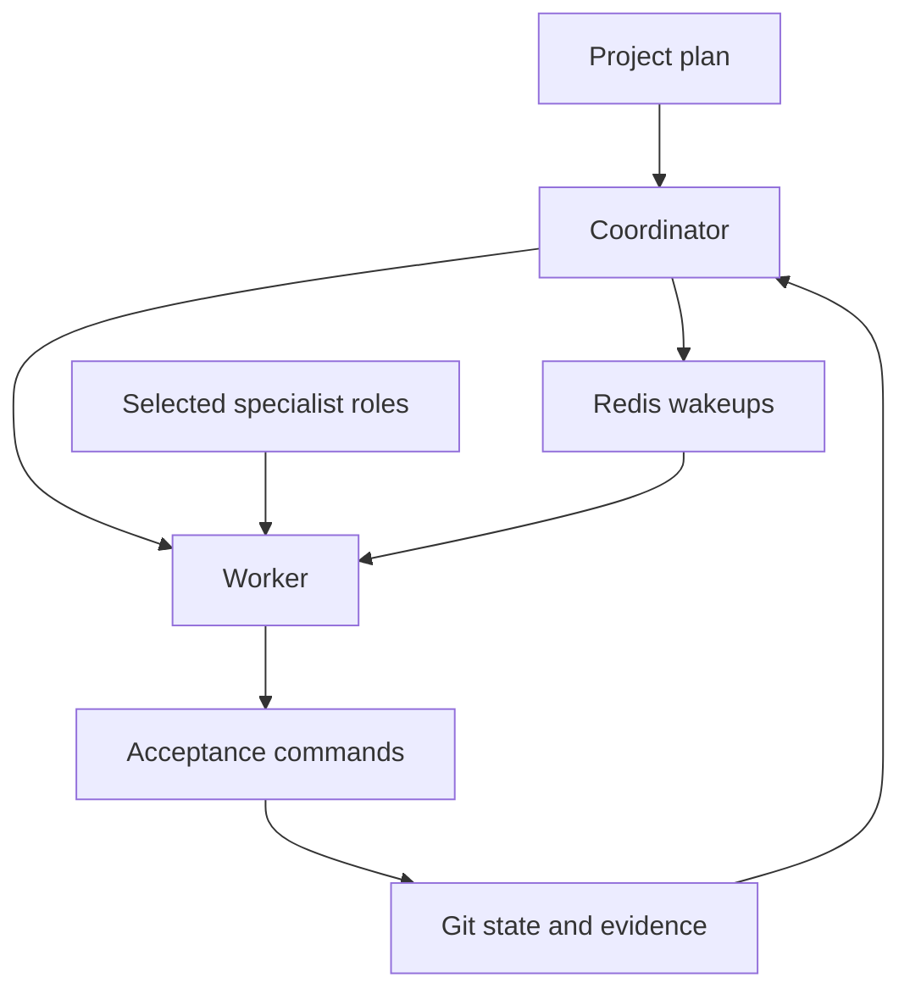

# Cloud Company Kit

[](LICENSE)
[](https://github.com/jinghai123a/Cloud-Company-Kit/actions/workflows/ci.yml)
[](https://github.com/jinghai123a/Cloud-Company-Kit/actions/workflows/deploy-smoke.yml)

**Plan-driven AI agents. Recoverable cloud execution. Evidence-backed delivery.**

A self-hosted cloud workspace for Codex and multi-agent software delivery: one accountable coordinator, specialist roles activated by the project plan, Git-backed task state, and independent acceptance checks.

[中文](README.zh-CN.md) · [Workflow](docs/WORKFLOW.zh-CN.md) · [Cloud deployment](deploy/README.zh-CN.md) · [Configuration checklist](docs/CONFIGURE.zh-CN.md) · [Demo](examples/company_demo/README.md)

## Why this exists

Long tasks need durable state, useful delegation and verifiable outcomes. Cloud Company Kit connects those pieces without adding a second scheduler or requiring a private company repository.

- **Plan first:** run only the tasks and specialist roles the current phase needs.
- **Recoverable work:** persist inputs, checkpoints, retries and acceptance evidence in Git.
- **Independent verification:** separate worker output from the commands that accept it.
- **Local failure handling:** continue independent ready tasks while one capability is unavailable.
- **Configuration first:** reuse Compose, Redis/RQ, tool profiles and the existing project stack.
- **Project separation:** each customer project keeps its own repository, state and data volume.

## Architecture



The role catalog contains 28 optional roles across 14 responsibilities. It is a catalog, not 28 always-running agents. The shared workspace uses one top-level writer; independent subtasks can use native agents.

## Try it without cloud credentials

Python 3.11+ and Git are enough for the core and deterministic demo.

```bash
git clone https://github.com/jinghai123a/Cloud-Company-Kit.git
cd Cloud-Company-Kit
python3 -m venv .venv
. .venv/bin/activate
python -m pip install .
cloudkit setup --runtime-root /tmp/cloud-company-kit-runtime
cloudkit doctor --runtime-root /tmp/cloud-company-kit-runtime
python examples/company_rehearsal.py --output verification/company-rehearsal.json
python examples/company_demo/verify.py --output verification/company-http.json
```

The rehearsal exercises a real temporary Git repository, task dependencies, subprocess workers, acceptance and recovery. TaskDesk exercises HTTP, SQLite persistence and a usable interface. The demo workers are deterministic; connect your own Codex authentication for model-driven work.

## Run on a cloud server

1. Clone this repository onto a persistent Linux server with Docker and Compose.
2. Copy `deploy/.env.example` to `deploy/.env` and enter your independent business repository identity.
3. Place its Git credential in the configured secret file and complete Codex device authentication once.
4. Start the included services:

```bash
bash deploy/cloudkit.sh login
bash deploy/cloudkit.sh up
bash deploy/cloudkit.sh status
```

The image includes the role configuration. No private headquarters, policy or runtime repository is required. Detailed commands, credential locations, health checks, backups and restore procedures are in the [deployment guide](deploy/README.zh-CN.md).

## What is included

| Directory | Purpose |
| --- | --- |
| `src/cloudkit/` | Existing CLI, supervisor, Git state, coordination, memory and queue integrations |
| `deploy/` | Compose operation, model readiness, backup and recovery |
| `.codex/` | Task-scoped specialist role configuration |
| `company/` | Organization catalog and blank phase report |
| `templates/` | Project intake, main/fallback plan and editor recommendations |
| `examples/` | Synthetic task-graph rehearsal and TaskDesk application |
| `tests/` | Runtime and public-distribution regression checks |

Optional memory, language, design, queue and code-intelligence profiles are prepared when the plan needs them. Browser research uses Firefox, Chrome and Edge, with Wikipedia as a reference entry point; research is activated only for tasks that require it.

## Verify a change

```bash
python -m unittest discover -s tests -v
python -m unittest discover -s deploy -p 'test_*.py' -v
python -m unittest discover -s templates/tests -v
bash -n deploy/*.sh
```

For container integration, run `bash deploy/smoke.sh` on a Docker host. Workflow paths select the relevant CI checks. [Contributing](CONTRIBUTING.md) explains small patches, independent evidence and reusable regression cases.

## License

[Unlicense](LICENSE). Optional packages retain their own licenses.
